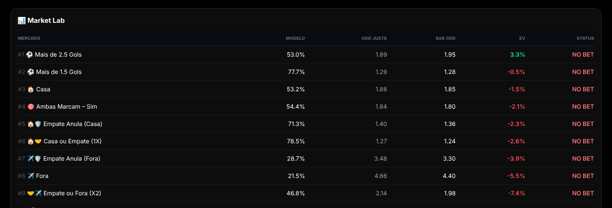

# Quantify Sports

Motor quantitativo em TypeScript que estima probabilidades de resultados de partidas de futebol e avalia se uma cotação tem valor esperado positivo.

🌐 [Abrir o app](https://gustavoserafim10.github.io/ProjetoQuantiFy/)

Projeto pessoal criado para praticar modelagem estatística, arquitetura em camadas e testes automatizados em um problema com dados reais.

## O que ele faz

1. Recebe os dados de uma partida (médias de gols, contexto, cotações) pelo painel de entrada.
2. Estima a taxa de gols de cada time (λ) com ajustes de ataque, defesa, mando de campo e qualidade dos dados.
3. Gera a distribuição de placares com **Poisson** e correção **Dixon-Coles** para placares baixos.
4. Roda **simulações de Monte Carlo** para medir a variação do resultado.
5. Compara a probabilidade do modelo com a **probabilidade implícita** da cotação e calcula o **valor esperado (EV)**.
6. Aplica regras de risco, dimensiona a entrada com **Kelly fracionado** e classifica os mercados.
7. Mostra o resultado e a explicação de cada decisão no dashboard.

Exemplo de saída com dados fictícios: o **Market Lab** compara a probabilidade do modelo com a cotação de cada mercado e só recomenda entrada quando o EV passa pelas regras de risco.



## Arquitetura

O código separa regras de negócio, orquestração e interface:

```
src/
├── domain/        # matemática e regras puras (modelos, distribuições, odds, risco, calibração)
├── application/   # pipelines e orquestração (modelo → simulação → valor → risco → decisão) e backtests
└── ui/            # componentes React do painel e do dashboard
```

Fluxo de uma análise:

```
Contexto → Modelo (λ) → Simulação → Probabilidade → Valor (EV) → Risco → Ranking → Decisão
```

Cada etapa é um pipeline independente, testado separadamente.

## Stack

- React 19 + TypeScript + Vite
- Recharts e Framer Motion na interface
- Vitest para testes (39 arquivos de teste)
- Scripts de backtest e relatório de robustez com `tsx`
- Deploy automático no GitHub Pages via GitHub Actions

## Como rodar

```bash
npm install
npm run dev          # ambiente local
npm test             # testes
npm run typecheck    # checagem de tipos
npm run backtest:robustness   # relatório de robustez do modelo
```

## Limitações

- É um projeto de estudo. As probabilidades dependem da qualidade dos dados informados.
- Não há integração com casas de apostas nem coleta automática de dados.
- Os resultados do backtest não garantem desempenho futuro.

## Autor

Gustavo Vinicius — [LinkedIn](https://www.linkedin.com/in/gustavo-vinicius-961594219/)
